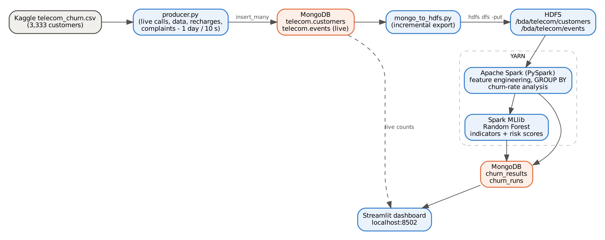

# Real-Time Telecom Customer Churn Analysis & Risk Scoring

[](https://www.python.org/)
[](https://spark.apache.org/)
[](https://hadoop.apache.org/)
[](https://www.mongodb.com/)
[](https://streamlit.io/)

A complete Big Data Analytics pipeline simulating and analyzing real-time telecom customer activity, extracting behavioral churn patterns, training a distributed machine learning model using **Apache Spark MLlib**, and presenting live predictions and risk scores on an interactive **Streamlit** dashboard.

---

## 📌 Project Overview

**Problem Statement (Big Data Analytics Q45):**
> *Given telecom customer data containing call duration, data usage, recharge history, complaints, service plan, and customer status, use Spark to identify behavioural patterns associated with churn and determine important churn indicators.*

### End-to-End Pipeline Workflow:
1. **Live Data Streaming (MongoDB):** A Python producer streams day-by-day telecom activity (calls, roaming, mobile data sessions, plan recharges, and customer care complaints) into MongoDB.
2. **Incremental Ingestion (HDFS):** Incremental events are extracted and ingested into Hadoop Distributed File System (`/bda/telecom/events`).
3. **Distributed Big Data Analytics (Apache Spark on YARN):** Spark aggregates event streams per customer, normalizes metrics into monthly behavioral profiles, and runs statistical segmentations.
4. **Machine Learning & Risk Scoring (Spark MLlib):** A class-weighted **Random Forest Classifier** identifies top churn indicators and predicts churn probability for all currently active customers.
5. **Real-Time Visualization (Streamlit):** An interactive web dashboard displays churn rates, feature importances, top at-risk customers, and activity breakdowns.



---

## 🛠️ Tech Stack

| Technology | Version | Purpose |
|---|---|---|
| **Apache Spark** | 3.5.3 | Distributed feature aggregation, PySpark DataFrame operations, MLlib Random Forest |
| **Apache Hadoop** | 3.3.6 | HDFS distributed storage & YARN cluster resource management |
| **MongoDB** | 8.0 | High-throughput document store for incoming event streams and analytical results |
| **Python** | 3.10 | Core pipeline scripting (PyMongo, PySpark, Pandas, NumPy) |
| **Streamlit** | 1.40+ | Real-time web dashboard & interactive analytics UI |
| **Ubuntu (WSL2)** | 22.04 LTS | Linux execution environment on Windows |
| **Java** | OpenJDK 8 | Runtime environment for Hadoop and Spark daemons |

---

## 📁 Repository Structure

```text
├── churn_analysis.py       # Spark MLlib job: aggregates profiles, trains Random Forest, calculates risk scores
├── dashboard.py            # Streamlit dashboard for real-time monitoring and visualizations
├── mongo_to_hdfs.py        # Incremental pipeline: reads new events from MongoDB and loads into HDFS
├── producer.py             # Event generator: simulates dynamic daily customer events into MongoDB
├── run_pipeline.sh         # Shell script orchestrating one complete ingestion and Spark analysis cycle
├── requirements.txt        # Python package dependencies (PySpark, PyMongo, Streamlit, etc.)
├── docs/
│   ├── architecture.png    # System architecture flow diagram
│   ├── INSTALLATION.md     # Complete step-by-step installation guide from scratch
│   ├── RUNNING.md          # Execution commands, monitoring, and reset instructions
│   └── HOW_IT_WAS_BUILT.md # System design decisions, problem solving, and ML tuning details
├── results/                # Saved analytical reports and model evaluation outputs
└── telecom_dataset/        # Benchmark dataset directory (telecom_churn.csv)
```

---

## 📊 Benchmark Dataset

The base dataset is Kaggle's [Customer Churn (barun2104)](https://www.kaggle.com/datasets/barun2104/telecom-churn) (`telecom_churn.csv`):
- **3,333 customers**, 483 churned (14.49% base churn rate).
- Daily events (calls, roaming, data usage, recharges, complaints) are generated using customer-specific distribution profiles.
- **The Churn label is NEVER used during event simulation** — patterns detected by Spark originate purely from generated behavior.

---

## 🚀 Quick Start Guide

### Step 1: Prerequisites & Daemons
Ensure Hadoop, SSH, and MongoDB services are active inside Ubuntu 22.04:
```bash
sudo service ssh start
start-dfs.sh && start-yarn.sh
sudo systemctl start mongod

# Verify all 5 Hadoop services (NameNode, DataNode, SecondaryNameNode, ResourceManager, NodeManager)
jps
```

### Step 2: Install Python Dependencies
```bash
pip3 install -r requirements.txt
```

### Step 3: Run the 3-Terminal Workflow

#### 🖥️ Terminal 1 — Launch Streamlit Dashboard
```bash
python3 -m streamlit run dashboard.py --server.headless true --server.port 8502
```
> Open **http://localhost:8502** in your browser.

#### 📡 Terminal 2 — Start Live Data Streaming Producer
Simulate 30 days of activity (1 day generated every 10 seconds):
```bash
python3 producer.py telecom_dataset/telecom_churn.csv 30 10
```

#### ⚡ Terminal 3 — Run Incremental Spark Analysis
Execute the pipeline periodically while data streams (e.g. Day 10, Day 20):
```bash
./run_pipeline.sh
```

Once the producer finishes all 30 days, run the final cycle on **YARN**:
```bash
SPARK_MASTER=yarn ./run_pipeline.sh
```

---

## 📈 Key Findings & Results (30 Simulated Days / ~495k Events)

- **Top Churn Indicators (Random Forest Feature Importance):**
  1. `call_minutes` (~20.6% importance)
  2. `contract_renewal` (~19.4% importance)
  3. `complaints` (~15.8% importance)
  4. `avg_call_duration` (~11.2% importance)
  5. `data_gb` (~7.5% importance)

- **Behavioral Churn Drivers:**
  - **Complaints Impact:** Churn rate remains 10–13% for 0–3 complaints/month, jumping to **20.8% at 4 complaints** and **37.8% at 5+ complaints**.
  - **Service Plans:** Customers who did not renew their contract churn at **~40–44%**, whereas customers with a data plan who renewed churn at only **5.3%**.
  - **Call Volume:** Churners average **+18% higher call minutes** and longer individual call durations.

- **Model Evaluation:**
  - Class-weighted Random Forest (depth 6, 100 trees, 80/20 train/test split).
  - **ROC-AUC:** `~0.808`
  - **Accuracy:** `84.4%`
  - **Churn Recall:** Catches `~59.8%` of churners in the minority class (14.5% base rate).

---

## 🌐 Web Monitoring & Dashboards

- **Live Streamlit Dashboard:** `http://localhost:8502`
- **Hadoop HDFS Web UI:** `http://localhost:9870`
- **YARN Resource Manager:** `http://localhost:8088` (monitors active Spark applications on cluster)

---

## 🔄 Resetting the Project (Starting Fresh)

To clear all simulated data from MongoDB and HDFS and start from Day 0:
```bash
mongosh telecom --quiet --eval "db.dropDatabase()"
hdfs dfs -rm -r -f /bda/telecom
rm -rf exports last_export.txt results/spark_*.txt spark_errors.log
mkdir -p results
```

---

## 📖 Detailed Guides

- [Complete Installation Guide (WSL2, Hadoop, Spark, MongoDB)](docs/INSTALLATION.md)
- [How It Was Built & Engineering Decisions](docs/HOW_IT_WAS_BUILT.md)
- [Step-by-Step Running Guide](docs/RUNNING.md)

---

## 👤 Author

- **GitHub:** [@itschiru07](https://github.com/itschiru07)
