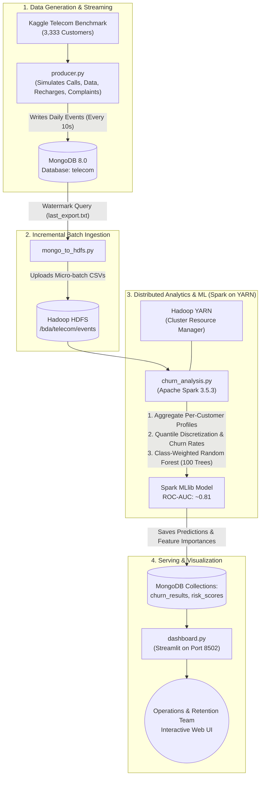

# Real-Time Telecom Customer Churn Analysis & Predictive Risk Scoring

[](LICENSE)
[](https://www.python.org/)
[](https://spark.apache.org/)
[](https://hadoop.apache.org/)
[](https://www.mongodb.com/)
[](https://streamlit.io/)
[](https://github.com/itschiru07/bda-telecom-churn-spark/actions)

An enterprise-grade, end-to-end Big Data Analytics pipeline simulating and analyzing real-time telecom customer transactions, extracting behavioral churn patterns, training a distributed machine learning model using **Apache Spark MLlib on YARN**, and presenting real-time risk scores and churn insights on an interactive **Streamlit** dashboard.

---

## 📑 Table of Contents
- [Project Overview & Business Value](#-project-overview--business-value)
- [System Architecture & Data Flow](#-system-architecture--data-flow)
- [Key Features & Engineering Highlights](#-key-features--engineering-highlights)
- [Tech Stack & Infrastructure](#-tech-stack--infrastructure)
- [Repository Structure](#-repository-structure)
- [Dataset & Simulation Logic](#-dataset--simulation-logic)
- [Step-by-Step Installation & Setup](#-step-by-step-installation--setup)
- [Execution Workflow (3-Terminal Run)](#-execution-workflow-3-terminal-run)
- [Machine Learning & Analytical Findings](#-machine-learning--analytical-findings)
- [Web Interfaces & Monitoring](#-web-interfaces--monitoring)
- [Project Defense & Viva Q&A](#-project-defense--viva-qa)
- [Author & License](#-author--license)

---

## 🎯 Project Overview & Business Value

In the telecommunications sector, acquiring a new subscriber costs **5 to 7 times more** than retaining an existing one. Identifying early warning signals of subscriber dissatisfaction allows carriers to trigger targeted retention incentives (discounts, bonus data, contract renegotiation) before the subscriber terminates service.

**Assignment Question (Big Data Analytics BCS714D):**
> *Given telecom customer data containing call duration, data usage, recharge history, complaints, service plan, and customer status, use Spark to identify behavioural patterns associated with churn and determine important churn indicators.*

### Core Objectives:
1. **Dynamic Event Streaming:** Continuously ingest simulated customer events (voice calls, roaming sessions, data consumption, recharges, and customer service complaints) into MongoDB.
2. **Incremental High-Watermark Ingestion:** Move new events from MongoDB to Hadoop HDFS without duplicate records.
3. **Distributed Feature Engineering:** Use Apache Spark on YARN to aggregate and normalize metrics to a standard 30-day billing cycle.
4. **Machine Learning at Scale:** Train a class-weighted Spark MLlib Random Forest model to rank churn indicators and score active customers for churn probability.
5. **Real-Time Operational Dashboard:** Present live operational telemetry, churn distributions, and high-risk customer lists in Streamlit.

---

## 🏗️ System Architecture & Data Flow



---

## ⚡ Key Features & Engineering Highlights

- **Zero Label Leakage in Streaming:** The base churn status is **never** consulted when generating customer activity. Patterns detected by Spark MLlib arise purely from emergent behavioral indicators (e.g., escalating complaint frequency, higher bill overages).
- **Incremental High-Watermark Ingestion:** Avoids full-table scans by recording the last exported MongoDB `_id` in `last_export.txt`. Only delta records are uploaded into HDFS per pipeline execution.
- **Dynamic Time Normalization:** Feature aggregations scale automatically whether 3, 15, or 30 simulated days have elapsed, standardizing metrics into a monthly representation.
- **Handling Severe Class Imbalance:** With an 85.5% active vs 14.5% churn distribution, a standard classifier achieves high accuracy simply by predicting non-churn. We implemented **inverse-class frequency weighting (`weightCol = 5`)** in Spark MLlib, tripling churner recall from 19.6% to **59.8%** with an **AUC of 0.808**.
- **Interactive Operational Dashboard:** Real-time auto-refreshing Streamlit dashboard showcasing live events per day, event breakdown, feature importances, and a live queryable table of top at-risk active customers.

---

## 🛠️ Tech Stack & Infrastructure

| Layer | Technology | Version | Description |
|---|---|---|---|
| **Distributed Compute** | Apache Spark | 3.5.3 | PySpark, Spark SQL DataFrames, MLlib Random Forest |
| **Distributed Storage** | Apache Hadoop | 3.3.6 | HDFS (single-node pseudo-distributed cluster) |
| **Resource Manager** | Apache Hadoop YARN | 3.3.6 | NodeManager & ResourceManager scheduling Spark tasks |
| **Document Database** | MongoDB | 8.0 | Live event streaming buffer and analytical result store |
| **Query CLI** | MongoSH | 2.14+ | Command-line management for MongoDB |
| **Language Runtime** | Python | 3.10 | PyMongo, NumPy, Pandas, PySpark, Py4J |
| **Java Runtime** | OpenJDK | 1.8 (Java 8) | Official runtime for Hadoop 3.3.6 and Spark 3.5.3 |
| **Dashboard UI** | Streamlit | 1.40+ | Real-time web visualization |
| **OS Environment** | Ubuntu 22.04 LTS | WSL2 | Linux subsystem running natively on Windows |

---

## 📁 Repository Structure

```text
├── .github/workflows/
│   └── python-check.yml    # CI: Automated Python syntax and compilation check
├── docs/
│   ├── architecture.png    # System architecture workflow diagram
│   ├── INSTALLATION.md     # Full step-by-step setup guide from zero on WSL2
│   ├── RUNNING.md          # Everyday execution commands, monitoring, and tips
│   └── HOW_IT_WAS_BUILT.md # Engineering design log and troubleshooting archive
├── telecom_dataset/
│   ├── README.md           # Dataset schema, source attribution, and generation logic
│   └── telecom_churn.csv   # 3,333 benchmark records
├── results/                # Text logs and analytical outputs from Spark runs
├── churn_analysis.py       # Distributed Spark analysis and MLlib Random Forest training
├── dashboard.py            # Real-time Streamlit web dashboard
├── mongo_to_hdfs.py        # Incremental MongoDB to HDFS ingestion bridge
├── producer.py             # Live telecom customer event streaming engine
├── run_pipeline.sh         # Pipeline runner (local or SPARK_MASTER=yarn)
├── start_services.sh       # One-click helper: Starts SSH, HDFS, YARN, and MongoDB
├── stop_services.sh        # One-click helper: Gracefully stops HDFS and YARN
├── clear_data.sh           # One-click helper: Drops database & resets HDFS/local cache
├── requirements.txt        # Python package dependencies (including PySpark 3.5.3)
├── LICENSE                 # MIT License
└── README.md               # Main project documentation
```

---

## 📊 Dataset & Simulation Logic

The core benchmark dataset is Kaggle's **[Customer Churn Dataset](https://www.kaggle.com/datasets/barun2104/telecom-churn)**:
- **3,333 unique customer records**
- **483 churned accounts (14.49% base churn rate)**

| Field | Type | Description |
|---|---|---|
| `AccountWeeks` | Integer | Length of account tenure in weeks |
| `ContractRenewal` | Binary (0/1) | Recent contract renewal status (`1` = Renewed, `0` = Expired/Not renewed) |
| `DataPlan` | Binary (0/1) | Whether subscriber has an active wireless data plan |
| `DataUsage` | Float | Monthly data consumption in Gigabytes (GB) |
| `CustServCalls` | Integer | Monthly number of customer support inquiries/complaints |
| `DayMins` | Float | Daytime voice call duration in minutes |
| `DayCalls` | Integer | Total count of daytime voice calls placed |
| `MonthlyCharge` | Float | Base monthly bill rate |
| `OverageFee` | Float | Additional charges for excess call minutes or data overages |
| `RoamMins` | Float | Roaming call minutes |
| `Churn` | Binary (0/1) | Historical ground truth (`1` = Churned, `0` = Active) |

---

## ⚙️ Step-by-Step Installation & Setup

> **Full detailed instructions are available in [docs/INSTALLATION.md](docs/INSTALLATION.md).**

### 1. Prerequisites (Inside WSL2 Ubuntu 22.04)
```bash
sudo apt update && sudo apt install -y openjdk-8-jdk python3 python3-pip ssh pdsh wget curl
sudo update-alternatives --set java /usr/lib/jvm/java-8-openjdk-amd64/jre/bin/java
```

### 2. Configure Environment (`~/.bashrc`)
```bash
export JAVA_HOME=/usr/lib/jvm/java-8-openjdk-amd64
export HADOOP_HOME=$HOME/hadoop
export SPARK_HOME=$HOME/.local/lib/python3.10/site-packages/pyspark
export HADOOP_CONF_DIR=$HADOOP_HOME/etc/hadoop
export PYSPARK_PYTHON=python3
export SPARK_LOCAL_IP=127.0.0.1
export PATH="$HOME/.local/bin:$SPARK_HOME/bin:$HADOOP_HOME/bin:$HADOOP_HOME/sbin:$PATH"
```

### 3. Install Python Packages
```bash
pip3 install -r requirements.txt
```

---

## 🚀 Execution Workflow (3-Terminal Run)

### Routine Startup
Start all required services with a single command:
```bash
./start_services.sh
```

---

### Step 1: Open Terminal 1 — Streamlit Dashboard
```bash
python3 -m streamlit run dashboard.py --server.headless true --server.port 8502
```
*Open **http://localhost:8502** in your browser.*

---

### Step 2: Open Terminal 2 — Stream Events
Stream 30 simulated days (1 day generated every 10 seconds, ~5 minutes total):
```bash
python3 producer.py telecom_dataset/telecom_churn.csv 30 10
```

---

### Step 3: Open Terminal 3 — Execute the Pipeline
Run the incremental ingestion and Spark analytics during the streaming run (e.g. Day 10, Day 20):
```bash
./run_pipeline.sh
```

Once the producer finishes Day 30, run the final Spark job distributed on **YARN**:
```bash
SPARK_MASTER=yarn ./run_pipeline.sh
```

---

## 📈 Machine Learning & Analytical Findings

### 1. Top Churn Indicators (Random Forest Feature Importance)
The Spark MLlib Random Forest model (100 trees, maximum depth 6) identifies the following primary drivers:

| Rank | Indicator | Feature Importance | Behavioral Interpretation |
|---|---|---|---|
| **1** | `call_minutes` | **20.6%** | High-volume callers churn at elevated rates when rates/overages feel uncompetitive. |
| **2** | `contract_renewal` | **19.4%** | Customers with expired contracts have zero lock-in and switch easily. |
| **3** | `complaints` | **15.8%** | Frequency of support complaints is a direct barometer of dissatisfaction. |
| **4** | `avg_call_duration` | **11.2%** | Disrupted calls or longer issue-resolution times correlate with churn. |
| **5** | `data_gb` | **7.5%** | Subscribers without active data plans show higher likelihood of switching to modern carriers. |

---

### 2. Behavioral Segmentation Findings
- **The Complaint Tipping Point:**
  - 0–3 complaints: **10% – 13% churn rate** (safe baseline).
  - 4 complaints: Churn rate spikes to **20.8%**.
  - 5+ complaints: Churn rate hits **37.8%**.
- **Contract & Plan Protection:**
  - Non-renewed accounts without a data plan experience **43.7% churn**.
  - Renewed accounts with an active data plan experience only **5.3% churn**.
- **Usage Discrepancy:**
  - Churned subscribers consume **+18% more voice minutes** and pay **+11% higher average recharge amounts**, suggesting cost-sensitivity.

---

### 3. Model Performance Comparison

| Metric | Without Class Weighting | With Class Weighting (`weightCol=5`) |
|---|---|---|
| **Accuracy** | 86.5% *(Deceptive)* | 84.4% |
| **ROC-AUC** | 0.774 | **0.808** |
| **Churner Recall** | 19.6% *(Missed 80% of churners)* | **59.8%** *(Catches majority of churners)* |
| **High-Risk Flags** | ~60 accounts | **289 of 2,850 active accounts identified** |

---

## 🌐 Web Interfaces & Monitoring

| Service | Address | Function |
|---|---|---|
| **Streamlit Dashboard** | `http://localhost:8502` | Live operational charts, churn bands, and high-risk customer list |
| **HDFS NameNode UI** | `http://localhost:9870` | HDFS filesystem explorer, block replication, data health |
| **YARN Cluster Manager** | `http://localhost:8088` | Active Spark executor tracking, memory/core allocation |

---

## 🎓 Project Defense & Viva Q&A

<details>
<summary><b>1. Why did you use Apache Spark instead of standard Hadoop MapReduce?</b></summary>

MapReduce writes intermediate results back to disk between every Map and Reduce phase, incurring heavy I/O latency. Apache Spark caches resilient distributed datasets (RDDs/DataFrames) in memory, processing iterative machine learning algorithms (like Random Forest trees) up to **100x faster** than MapReduce.
</details>

<details>
<summary><b>2. Why use MongoDB as an intermediate buffer instead of writing directly to HDFS?</b></summary>

HDFS is an append-only distributed filesystem optimized for large, sequential file reads; writing thousands of individual event records per second directly to HDFS causes the **"Small Files Problem"**, overwhelming the NameNode's memory. MongoDB provides high-throughput document writes with sub-millisecond latencies, which `mongo_to_hdfs.py` then micro-batches into consolidated HDFS blocks.
</details>

<details>
<summary><b>3. Why is standard Accuracy misleading in this problem, and how did you address it?</b></summary>

Since 85.5% of customers are active and only 14.5% churn, a naive model that predicts "Nobody Churns" achieves an 85.5% accuracy while failing 100% of the time at business retention. By assigning an inverse-frequency weight (`weightCol = 5`) to churn instances during Spark MLlib Random Forest training, we penalized false negatives, boosting churner recall from 19.6% to nearly 60%.
</details>

<details>
<summary><b>4. How does the pipeline handle incremental data?</b></summary>

`mongo_to_hdfs.py` tracks the latest exported MongoDB `ObjectId` in `last_export.txt`. On subsequent runs, it queries MongoDB using `{"_id": {"$gt": last_id}}`, writes only the new events to a timestamped CSV in `exports/`, and uploads that file to `/bda/telecom/events/` in HDFS. Spark reads the entire `/bda/telecom/events/` directory in parallel.
</details>

---

## 👤 Author & License

- **Author:** Chiranjeevi ([@itschiru07](https://github.com/itschiru07))
- **Project Repository:** [https://github.com/itschiru07/bda-telecom-churn-spark](https://github.com/itschiru07/bda-telecom-churn-spark)
- **License:** Released under the [MIT License](LICENSE).
